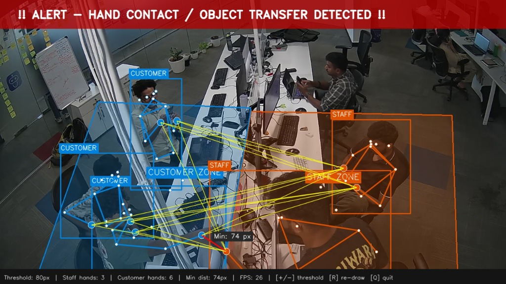

# 💍 CCTV Hand Interaction Monitor (Jewellery Store)

An intelligent, real-time computer vision system that monitors and detects hand-to-hand interactions (e.g., handing over jewellery items between staff and customers across counters) using **YOLOv8-Pose** estimation and RTSP IP camera streams.



---

## 📌 Features

- **Real-Time Keypoint Tracking**: Tracks wrists (with elbow fallback) using `yolov8m-pose`.
- **Custom Dual-Zone ROIs**: Interactive polygon drawing tool to define separate **Staff** and **Customer** zones.
- **Proximity & Cross-Zone Logic**: Computes Euclidean distance between wrists across zones to identify handovers accurately while ignoring self-touch or same-zone interactions.
- **Instant Audio & Snapshot Alerts**:
  - Windows sound alert (`winsound`) on trigger.
  - Automatic snapshot logging under the `alerts/` folder with timestamp and interaction details.
  - Cooldown timer (default 5s) to avoid alert spamming.
- **Dynamic Threshold Adjustment**: On-the-fly threshold tuning directly using `+` / `-` keys during live monitoring.
- **Persistent Configuration**: Stores polygon boundaries and distance thresholds in `roi_config.json`.

---

## 🏗️ Architecture & How It Works

```
[ RTSP CCTV Stream ]
         │
         ▼
[ YOLOv8-Pose Estimation ] ──> Detects wrists & elbows (COCO Keypoints 9, 10, 7, 8)
         │
         ▼
[ Zone Filtering ] ───────────> Validates wrist points within Staff ROI & Customer ROI
         │
         ▼
[ Distance Calculation ] ─────> Measures Euclidean distance between Staff & Customer wrists
         │
  [ Distance < Threshold ? ]
       ├── Yes ──> [ Audio Alert Beep ] + [ Save Snapshot in /alerts ]
       └── No  ──> [ Display Live Stream & Visual Proximity Line ]
```

---

## 📋 Prerequisites

- **Python**: 3.8+ (tested on Python 3.10+)
- **OS**: Windows (sound alerts use Windows built-in `winsound`)
- **Camera**: RTSP-compatible IP Camera / CCTV / NVR stream
- **GPU**: NVIDIA GPU with CUDA recommended for real-time FPS performance

---

## 🚀 Installation & Setup

### 1. Clone the Repository
```bash
git clone https://github.com/YOUR_USERNAME/jewellery-hand-interaction-monitor.git
cd jewellery-hand-interaction-monitor
```

### 2. Create a Virtual Environment
```bash
python -m venv venv
# On Windows:
venv\Scripts\activate
```

### 3. Install Dependencies
```bash
pip install -r requirements.txt
```

> **Note**: `yolov8m-pose.pt` will be automatically downloaded by Ultralytics on the first run if not present in the root directory.

---

## ⚙️ Configuration

Open `hand_interaction_monitor.py` and adjust the configuration parameters:

```python
# RTSP Stream Connection
# If your password contains '@', encode it as '%40'
RTSP_URL = "rtsp://username:password@IP_ADDRESS:PORT/cam/realmonitor?channel=1&subtype=0"

MODEL_PATH = "yolov8m-pose.pt"     # Model file
FRAME_WIDTH = 1280                 # Stream processing width
FRAME_HEIGHT = 720                 # Stream processing height
ALERT_COOLDOWN = 5.0               # Seconds between successive alerts
DEFAULT_THRESHOLD = 180            # Proximity distance threshold (pixels)
KP_CONF_THRESHOLD = 0.35           # Keypoint confidence threshold
```

> [!WARNING]
> **Security Notice**: Do **NOT** commit hardcoded camera passwords or private RTSP credentials to a public GitHub repository. Use environment variables or a `.env` file for credentials.

---

## 🎮 Usage

Run the monitor:
```bash
python hand_interaction_monitor.py
```

### 1. Defining Zones (ROI Setup Phase)
If no `roi_config.json` exists (or when you press `R`), you will be prompted to draw zones on a freeze frame:
- **Phase 1**: Left-click to create points for the **Staff Zone** polygon.
- **Phase 2**: Left-click to create points for the **Customer Zone** polygon.

| Action | Control |
|---|---|
| **Add Polygon Point** | `Left-Click` |
| **Complete Current Zone Early** | `Right-Click` |
| **Reset & Redraw Both Zones** | `R` |
| **Save ROIs & Start Monitoring** | `S` |
| **Quit** | `Q` |

### 2. Live Monitoring Phase

| Key | Action |
|---|---|
| `+` or `=` | Increase proximity threshold (+10 px) |
| `-` or `_` | Decrease proximity threshold (-10 px) |
| `R` | Re-open ROI setup and redraw zones |
| `Q` | Quit application |

---

## 📂 Project Structure

```
├── alerts/                     # Automatically saved interaction alert snapshots
├── assets/                     # Demo screenshots and documentation assets
├── hand_interaction_monitor.py  # Main pipeline and visualization script
├── requirements.txt            # Python dependencies
├── roi_config.json             # Saved ROI polygons and sensitivity threshold
└── README.md                   # Project documentation
```

---

## 🛡️ Recommended `.gitignore`

Before pushing to GitHub, avoid uploading large weights, recorded alerts, and sensitive config:

```gitignore
# Python artifacts
__pycache__/
*.py[cod]
venv/
.env

# YOLO weights (large file ~50MB+)
*.pt

# Saved snapshot alerts
alerts/*.jpg
alerts/*.png

# Machine-specific / sensitive config
roi_config.json
```

---

## 📄 License

This project is licensed under the [MIT License](LICENSE).

